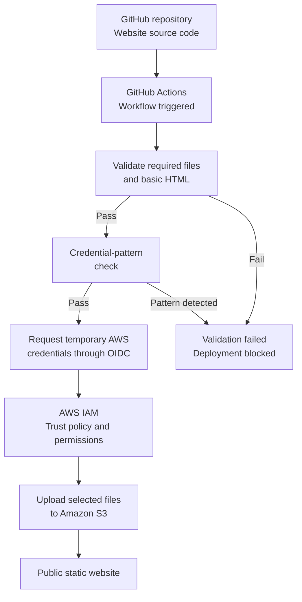

# Operation Skyfall

**A Secure CI/CD Pipeline Using GitHub Actions, AWS OIDC, IAM, and Amazon S3**

## Overview

Operation Skyfall is a fictional intelligence mission portal developed as a beginner DevOps project. It demonstrates how a static website can be validated and deployed to Amazon S3 through an automated CI/CD pipeline built with GitHub Actions.

Before deployment, the pipeline checks that required website files exist, performs basic HTML validation, and scans selected website source files for predefined credential patterns. If these checks fail, deployment is blocked.

For AWS authentication, the pipeline uses GitHub Actions OpenID Connect (OIDC) federation to obtain temporary AWS credentials instead of relying on long-lived AWS access keys stored in GitHub.

The project explores core DevOps and cloud security concepts, including automation, identity and access management, least-privilege permissions, deployment controls, failure testing, and security limitations.

## Project Objectives

- Build and host a static website on Amazon S3.
- Automate website validation and deployment using GitHub Actions.
- Configure GitHub OIDC federation for AWS authentication.
- Apply IAM trust conditions and least-privilege deployment permissions.
- Prevent deployment when website validation or credential-pattern checks fail.
- Capture evidence of pipeline behaviour through GitHub Actions logs and screenshots.
- Understand the limitations and risks of the chosen hosting and deployment approach.

## Architecture

The pipeline follows this deployment sequence:

1. Website source code is maintained in a GitHub repository.
2. A push to `main` or a manual workflow dispatch triggers GitHub Actions.
3. The validation job checks for required website files and performs basic HTML validation.
4. A credential-pattern check examines the specified website source files.
5. If either check fails, the validation job fails and the dependent deployment job is prevented from running.
6. If validation succeeds, the deployment job requests temporary AWS credentials through GitHub OIDC.
7. AWS IAM evaluates the role's trust policy and permissions before granting access.
8. GitHub Actions uploads the explicitly selected website files to the designated S3 bucket.
9. Amazon S3 serves the static website. Workflow logs and Git commit identifiers help trace and troubleshoot deployments.

### Architecture Diagram



## Security Controls

### Identity and Access Management

- **OIDC federation:** Allows GitHub Actions to obtain temporary AWS credentials without storing long-lived AWS access keys in GitHub.
- **IAM trust policy:** Restricts which GitHub identity and repository context can assume the deployment role, according to the configured trust conditions.
- **Least-privilege permissions:** The deployment role is intended to have only the AWS permissions required for the specified S3 deployment.
- **Scoped access:** Deployment permissions should be restricted to the intended S3 bucket and required operations wherever possible.

### CI/CD Pipeline Controls

- **Website validation:** Checks for required files and basic HTML structure before deployment.
- **Credential-pattern detection:** Searches selected website source files for predefined patterns associated with potentially exposed credentials.
- **Deployment gating:** The deployment job depends on successful completion of the validation job.
- **Explicit file selection:** The workflow uploads the intended website files rather than copying the entire repository.
- **Deployment traceability:** Git commit identifiers, workflow logs, and generated version information help identify and troubleshoot deployments.

These controls reduce specific risks but do not guarantee that the website or pipeline is free from vulnerabilities. Their effectiveness depends on the actual workflow configuration, IAM policies, repository settings, and testing.

## Testing and Evidence

Two tests were designed to demonstrate how the pipeline responds to invalid website content and potentially exposed credentials.

### Test 1 — Website Validation Failure

**Objective:** Verify that invalid website content causes validation to fail and prevents deployment.

**Procedure:**

1. Introduce a deliberate HTML error that causes one of the configured validation checks to fail.
2. Commit the test change and allow the GitHub Actions workflow to run.
3. Inspect the workflow logs and confirm that the validation job fails.
4. Confirm that the deployment job is skipped because its required validation job did not succeed.
5. Restore the original HTML and verify that the workflow succeeds again.

**Expected result:** The validation job fails, and the deployment job does not run. After the website content is restored, the pipeline should succeed.

**Evidence**

The following screenshots document the validation test and the pipeline's response.


### Test 2 — Credential-Pattern Detection

**Objective:** Verify that the predefined credential-pattern check detects a matching test string and prevents deployment.

**Procedure:**

1. Create a harmless, clearly fake test string that matches one of the configured detection patterns.
2. Add the string to a website source file included in the check.
3. Commit the test change and run the workflow.
4. Inspect the workflow logs and confirm that the check reports a matching pattern.
5. Verify that validation fails and the deployment job does not proceed.
6. Remove the test string and verify that the workflow succeeds again.

**Expected result:** A matching test pattern causes validation to fail, blocking deployment until the test string is removed.

**Evidence**

The following screenshots document the credential-pattern test and its results.


## Limitations and Risks

Operation Skyfall is a learning project designed to demonstrate core DevOps and cloud security concepts. It is not a production-hardened hosting platform.

- **HTTP-only website endpoint:** The standard Amazon S3 static website endpoint does not support HTTPS directly. A production deployment requiring HTTPS would need an appropriate front-end service, such as Amazon CloudFront, with suitable TLS configuration.
- **Public website access:** The website is intended to be publicly accessible. All published content must therefore be fictional and non-sensitive.
- **Non-atomic deployment:** Files are uploaded individually. During an update, visitors may temporarily encounter a mixture of old and new files.
- **Credential detection limitations:** Pattern matching is limited by the patterns and files configured for inspection. It cannot guarantee that credentials will never be exposed.
- **Audit limitations:** GitHub Actions logs and commit identifiers support troubleshooting and traceability but do not constitute a complete, tamper-resistant audit system.
- **Rollback:** Reverting a Git commit can restore earlier website content through a new deployment. The recovery process should be tested before rollback capability is considered verified.
- **Cloud costs:** AWS usage may incur charges depending on the resources used, traffic, and configuration.

## Project Structure

```text
operation-skyfall/
├── .github/
│   └── workflows/
│       └── deploy.yml
├── screenshots/
├── index.html
├── style.css
├── script.js
├── version.json
└── README.md
```

### Key Files

| File | Purpose |
|---|---|
| `index.html` | Website structure and mission portal content. |
| `style.css` | Website styling and layout. |
| `script.js` | Client-side interactions. |
| `version.json` | Generated deployment version information. |
| `.github/workflows/deploy.yml` | Website validation, credential-pattern checks, and AWS deployment workflow. |
| `screenshots/` | Evidence captured during the documented tests. |
| `README.md` | Project documentation, architecture, security controls, limitations, and test evidence. |

## Key Learning Outcomes

Through this project, I gained practical experience with:

- Git and GitHub version control.
- GitHub Actions and automated CI/CD pipelines.
- Validation checks and job dependencies.
- Basic credential-pattern detection and its limitations.
- AWS IAM roles, trust policies, and least-privilege permissions.
- GitHub OIDC federation and temporary AWS credentials.
- Amazon S3 static website hosting.
- Deployment failure handling and workflow troubleshooting.
- Deployment recovery and rollback concepts.
- Technical documentation and evidence-based testing.

## Conclusion

Operation Skyfall demonstrates how GitHub Actions can automate the validation and deployment of a static website to Amazon S3 while using OIDC federation and scoped IAM permissions to control access to AWS.

The two test scenarios demonstrate how website validation failures and matching credential patterns can be used to block deployment. The project also highlights the limitations of basic pattern matching, public S3 website hosting, and multi-file deployments.

Overall, this project provided hands-on experience with core DevOps and cloud security concepts while reinforcing the importance of automated testing, controlled cloud access, clear documentation, and an honest assessment of security controls.
