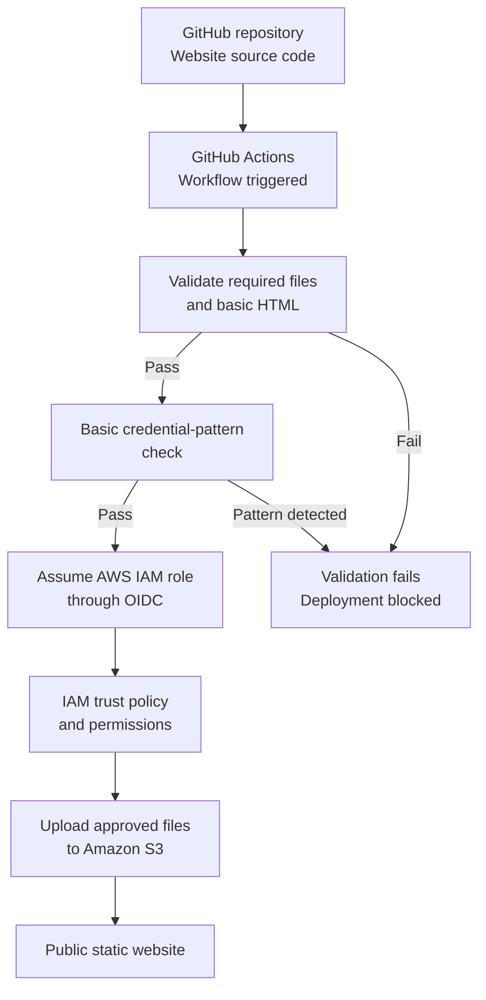

# Operation Skyfall

**A Secure CI/CD Pipeline Using GitHub Actions, AWS OIDC, IAM, and Amazon S3**

## Overview

Operation Skyfall is a fictional intelligence mission portal developed as a beginner DevOps project. It demonstrates how a static website can be validated and deployed to Amazon S3 through an automated CI/CD pipeline using GitHub Actions.

The pipeline performs basic website validation and a predefined credential-pattern check before allowing deployment to proceed. GitHub Actions authenticates to AWS through OpenID Connect (OIDC), allowing it to obtain temporary credentials rather than relying on long-lived AWS access keys stored in GitHub.

The project focuses on automation, cloud identity, least-privilege permissions, deployment controls, testing, and security awareness.

## Project Objectives

- Build and host a static website on Amazon S3.
- Automate website validation and deployment using GitHub Actions.
- Configure GitHub OIDC federation for AWS authentication.
- Apply IAM trust conditions and least-privilege deployment permissions.
- Block deployment when validation or the credential-pattern check fails.
- Protect the `main` branch against unintended changes.
- Capture evidence of pipeline behavior through GitHub Actions logs and screenshots.
- Understand the limitations and risks of the chosen hosting and deployment approach.

## Architecture

The deployment process follows this sequence:

1. Website source code is stored and version-controlled in GitHub.
2. A push to `main`, or a manual workflow run, triggers GitHub Actions.
3. The validation job checks that the required website files exist and performs basic HTML checks.
4. A basic credential-pattern check looks for selected patterns in the website source files.
5. If validation fails, the deployment job is blocked.
6. If validation succeeds, the deployment job requests temporary AWS credentials through GitHub OIDC.
7. AWS IAM evaluates the role's trust policy and permissions.
8. GitHub Actions uploads the explicitly selected website files to the intended S3 bucket.
9. Amazon S3 serves the static website, while workflow logs and commit identifiers help trace deployments.

### Architecture Diagram



## Security Controls

### Identity and Access Management

- **OIDC federation:** GitHub Actions obtains temporary AWS credentials without requiring long-lived AWS access keys in GitHub.
- **IAM trust policy:** Restricts which GitHub repository and branch context can assume the deployment role, according to the configured conditions.
- **Least-privilege permissions:** The deployment role is intended to have only the permissions required to upload the website files to the designated S3 bucket.

### CI/CD Pipeline Controls

- **Website validation:** Checks for required files and basic HTML structure before deployment.
- **Credential-pattern detection:** Checks selected website files for predefined patterns associated with potentially exposed credentials.
- **Deployment gating:** The deployment job depends on the successful completion of the validation job.
- **Explicit file uploads:** The workflow uploads the intended website files rather than copying the entire repository.
- **Branch protection:** Helps reduce the risk of unintended changes reaching the `main` branch.
- **Deployment traceability:** Workflow logs, Git commit SHAs, and generated deployment version information support troubleshooting and verification.

## Testing and Evidence

Two tests were selected to demonstrate how the pipeline handles invalid website content and potential credential patterns.

### Test 1 — Deliberately Break Validation

**Objective:** Verify that the pipeline rejects invalid website content and prevents deployment when validation fails.

**Procedure:**

1. Introduce a deliberate error into the HTML that causes one of the validation checks to fail.
2. Commit the test change and allow the GitHub Actions workflow to run.
3. Inspect the workflow logs and confirm that the validation job fails.
4. Confirm that the deployment job is skipped because its required validation job did not succeed.
5. Restore the original HTML and verify that the workflow succeeds again.

**Expected result:** Invalid website content causes validation to fail, preventing the deployment job from running.

**Evidence**

The following screenshots document the validation failure and the pipeline's response.


### Test 2 — Test the Basic Credential Detector

**Objective:** Verify that the predefined credential-pattern check identifies a matching test string and prevents deployment.

**Procedure:**

1. Use a harmless, clearly fake test string that matches one of the configured detection patterns.
2. Add the test string to one of the website source files checked by the workflow.
3. Run the workflow with the test change.
4. Inspect the logs and confirm that the pattern check reports a potential exposed credential.
5. Verify that validation fails and the deployment job does not proceed.
6. Remove the test string and confirm that the workflow succeeds again.

**Expected result:** A matching test pattern causes the check to fail, blocking deployment until the test string is removed.

**Evidence**

The following screenshots document the credential-pattern test and its results.


**Security limitation:** The credential detector uses predefined text patterns and checks only the specified website source files. It is a basic safeguard, not a comprehensive secret-scanning solution. It may miss credentials that do not match its configured patterns, and it does not necessarily inspect the full repository history.

## Limitations and Risks

Operation Skyfall is a learning project rather than a production-hardened hosting platform.

- **HTTP website endpoint:** The standard Amazon S3 static website endpoint does not provide HTTPS.
- **Public website access:** Website content is publicly accessible and must remain fictional and non-sensitive.
- **Non-atomic deployment:** Files are uploaded individually. During an update, visitors may briefly encounter a mixture of old and new files.
- **Audit limitations:** GitHub Actions logs and commit identifiers aid traceability but do not constitute a complete, tamper-resistant audit system.
- **Rollback:** A Git revert can restore earlier content through a new commit, but the recovery process should be tested before it is considered verified.
- **Cloud costs:** AWS usage may incur charges depending on the resources and configuration.

## Project Structure

```text
operation-skyfall/
├── .github/
│   └── workflows/
│       └── deploy.yml
├── screenshots/
├── index.html
├── style.css
├── script.js
├── version.json
└── README.md
```

- `index.html` — Website structure and mission portal content.
- `style.css` — Website styling and layout.
- `script.js` — Client-side interactions.
- `version.json` — Generated deployment version information.
- `.github/workflows/deploy.yml` — Website validation, credential-pattern check, and AWS deployment workflow.
- `screenshots/` — Evidence captured during the documented tests.
- `README.md` — Project documentation, architecture, security controls, limitations, and test evidence.

## Key Learning Outcomes

Through this project, I gained practical experience with:

- Git and GitHub version control.
- GitHub Actions and automated CI/CD pipelines.
- Validation checks and deployment dependencies.
- Basic credential-pattern detection and its limitations.
- AWS IAM roles, trust policies, and least-privilege permissions.
- GitHub OIDC federation and temporary AWS credentials.
- Amazon S3 static website hosting.
- Deployment failure handling and workflow troubleshooting.
- Branch protection and rollback concepts.
- Technical documentation and evidence-based testing.

## Conclusion

Operation Skyfall demonstrates how GitHub Actions can automate the validation and deployment of a static website to Amazon S3 while using OIDC federation and scoped IAM permissions to control access to AWS.

The two documented tests demonstrate how validation failures and matching credential patterns can prevent deployment. The project also highlights the limitations of basic pattern matching, public S3 website hosting, and multi-file deployments.

Overall, this project provided hands-on experience with core DevOps and cloud security concepts while reinforcing the importance of testing, clear documentation, and honest evaluation of security controls.
